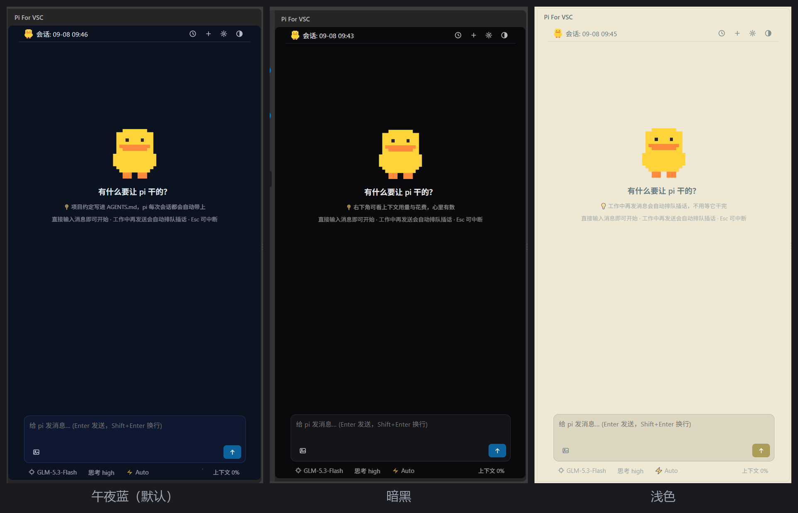
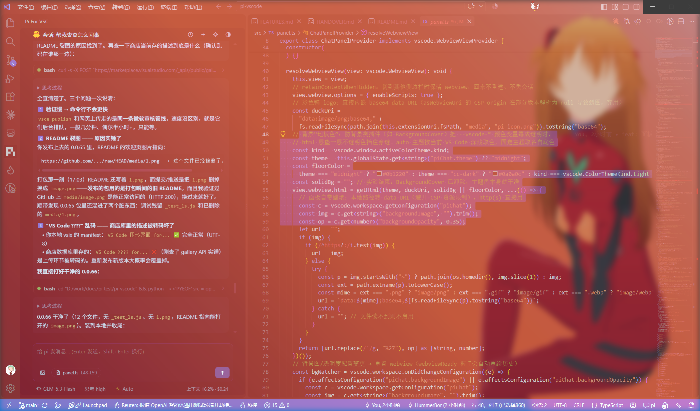
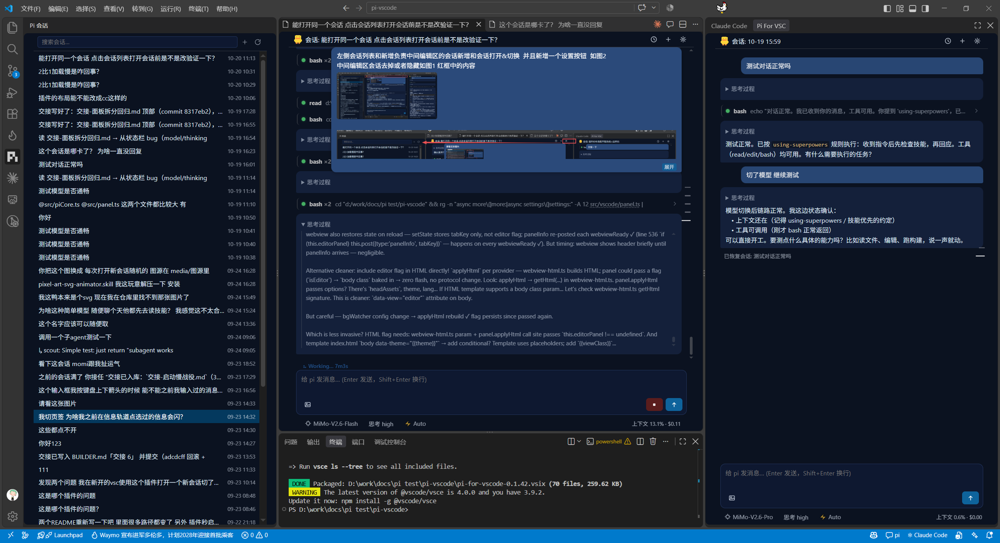
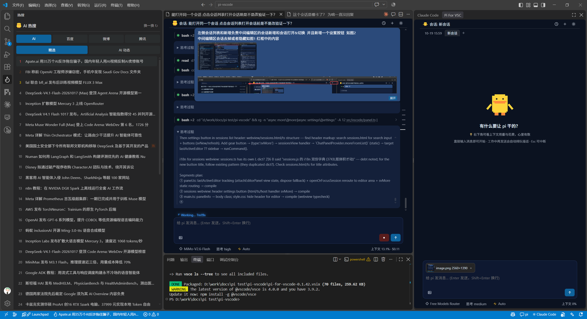

#  Pi For VSC

[简体中文](https://github.com/HummerBor/Pi-For-VS-code/blob/main/README.md) | [English](https://github.com/HummerBor/Pi-For-VS-code/blob/main/README_EN.md)

一个 [Pi](https://www.npmjs.com/package/@earendil-works/pi-coding-agent) 的可视化 VS Code 插件，把 pi 引擎进程内直连嵌进编辑器，流式体验与终端同速；交互参考 Claude Code，轻量不拖慢编辑器，界面代码就是几份本地文件，想改就改。

- **插件秒启动**：进程内直连 pi，面板即开即用，不 spawn 子进程、不等 CLI 冷启动
- **历史会话秒级加载**：会话列表指纹缓存，点历史毫秒级出列，翻旧会话不转圈

## 主题

- **跟随 VS Code**：按窗口深浅自动取色，配合壁纸插件也能融进背景

## 快速开始

在 [扩展商店](https://marketplace.visualstudio.com/items?itemName=HummerBor.pi-for-vscode) 搜 `Pi For VSC` 安装 → 点活动栏 pi 图标。没装 pi 会引导一键安装，没配 key 会引导配置，然后就能聊了：

## 搭配 Hot Duck 更香

一个窗口三栏到底：左侧栏放会话列表、中间编辑区干活、右侧挂 Pi 面板对话。左侧栏再换成 [Hot Duck](https://marketplace.visualstudio.com/items?itemName=HummerBor.hot-duck)（AI / 百度 / 微博 / 腾讯热搜榜），摸鱼信息流和干活界面并排，切过去只是一次侧栏点击：

## 面板白屏 / 报 `Could not register service worker`

VS Code **刚更新过**的第一个窗口里偶尔会这样：面板白屏，或者弹一句
`Error loading webview ... Could not register service worker: InvalidStateError ... The document is in an invalid state`。
这既不是插件崩了也不是会话坏了——是 VS Code 自己给 webview 用的 service worker 缓存还是上一个版本的，
新版本没能注册成功，于是 webview 压根没起来（会话都在磁盘上，一条都没丢）。

**修法**：命令面板搜 `pi: 修复 webview 缓存（退出 VS Code 后生效）` 执行，然后**自己退出 VS Code**（三分钟内），退出后缓存会被自动清掉，再手动打开 VS Code 即可。
（插件启动时也会自己检测并提示；它不会自己关你的窗口。）
手动等价操作：完全退出 VS Code → 删掉配置目录下的 `Service Worker` 和 `Cache` 两个文件夹 → 重新打开。

## 用它开发它自己

它的每个版本都是在自己的面板里做出来的：打开项目 → 跟 pi 说「把欢迎页的鸭子换个姿势」→ 它改源码、编译、打包出新 `.vsix` → 装上重载——**它就更新了它自己**，包括你现在看的这段 README。

有需求或问题，欢迎提 [Issue](https://github.com/HummerBor/Pi-For-VS-code/issues)。祝你干活愉快，记得喝水 

## 许可

[MIT](https://github.com/HummerBor/Pi-For-VS-code/blob/main/LICENSE)
