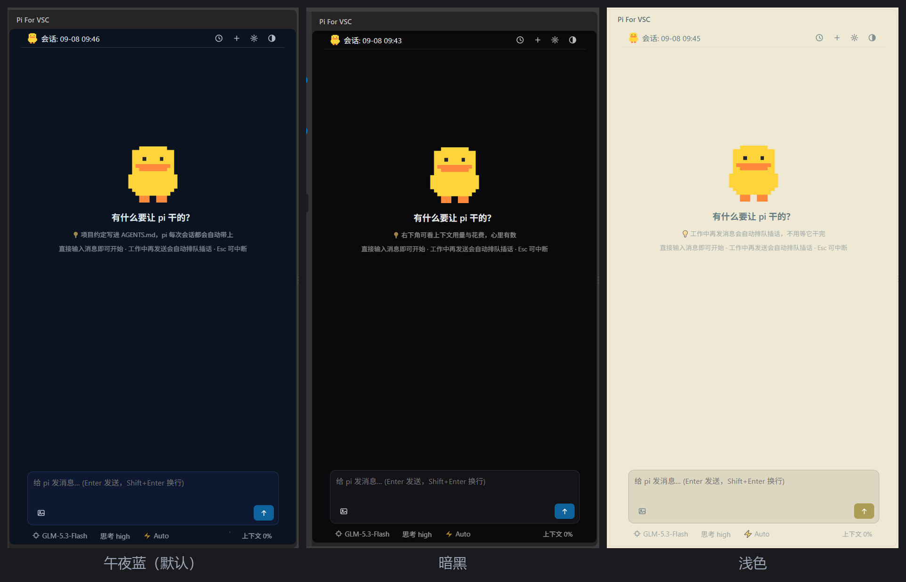
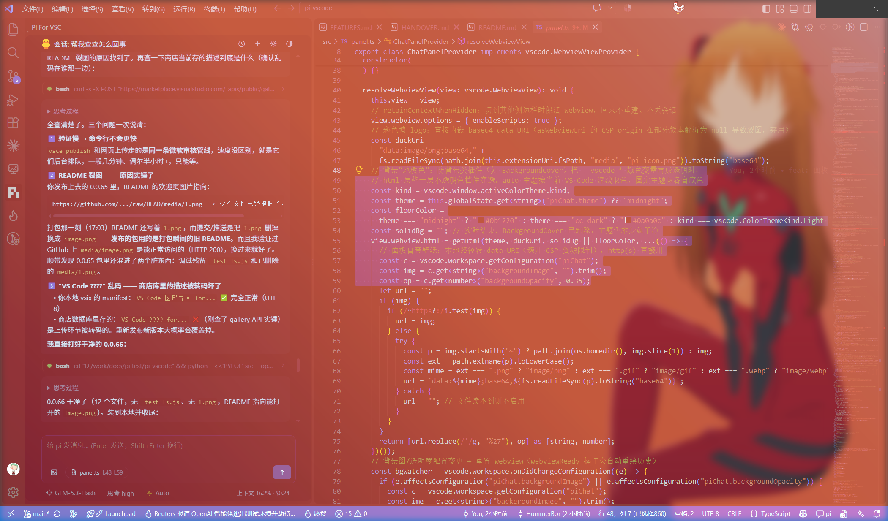
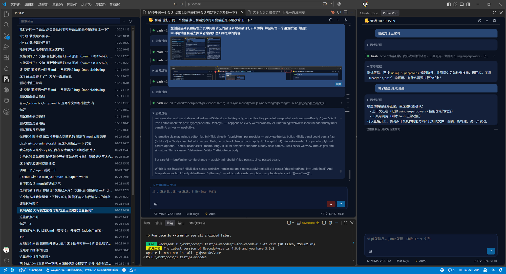
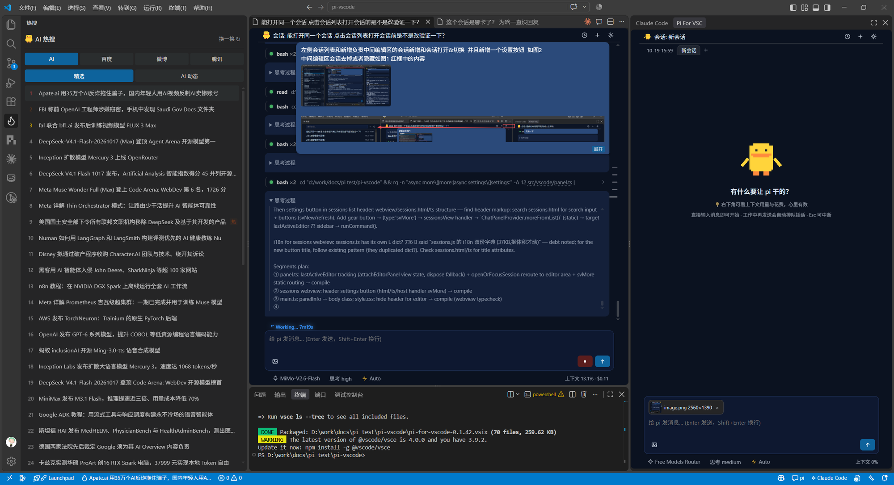

#  Pi For VSC

[English](https://github.com/HummerBor/Pi-For-VS-code/blob/main/README_EN.md) | [简体中文](https://github.com/HummerBor/Pi-For-VS-code/blob/main/README.md)

A visual VS Code extension for [Pi](https://www.npmjs.com/package/@earendil-works/pi-coding-agent) that embeds the pi engine in-process — streaming as fast as the terminal. Claude Code-style interaction; lightweight, and the UI is yours to tweak — it's just a few local files; edit and reload.

- **Starts in a second**: in-process pi, no subprocess spawn, no CLI cold start — the panel is ready the moment you open it
- **History loads instantly**: session list served from a fingerprint cache, past sessions pop up in milliseconds

## Themes

- **Follows VS Code**: adapts to the window's color scheme; blends into wallpaper extensions too

## Getting started

Search `Pi For VSC` in the [Marketplace](https://marketplace.visualstudio.com/items?itemName=HummerBor.pi-for-vscode) → click the pi icon in the activity bar. Missing pi triggers a one-click install; missing keys walk you through setup. Then just chat:

## Even better with Hot Duck

One window, three columns: session list in the sidebar, code in the editor, pi in the side panel. Swap the sidebar for [Hot Duck](https://marketplace.visualstudio.com/items?itemName=HummerBor.hot-duck) (AI / Baidu / Weibo / Tencent trending charts) — your feed and your work side by side, and switching is just one click:

## Blank panel / `Could not register service worker`

Rarely happens in the first window after **VS Code itself was updated**: the pi panel is blank, or you get
`Error loading webview ... Could not register service worker: InvalidStateError ... The document is in an invalid state`.
Nothing is broken in the extension and no conversation is lost — VS Code's own service-worker cache for
webviews still belongs to the previous build, the new build never got registered, so the webview never loaded.

**Fix**: run `pi: 修复 webview 缓存（退出 VS Code 后生效）` from the Command Palette, then **quit VS Code yourself** within three minutes —
the cache is cleared as soon as it exits, reopen VS Code afterwards (the extension also detects this on startup and offers
the same fix; it never closes your window for you). Manual equivalent: quit VS Code, delete the
`Service Worker` and `Cache` folders in the profile directory, start VS Code again.

## Built with itself

Every version of this extension was built inside its own panel: open the project → tell pi "change the duck's pose on the welcome page" → it edits the source, compiles, packages a new `.vsix` → install and reload — **it updates itself**, including the README you're reading.

Requests or bugs welcome at [Issues](https://github.com/HummerBor/Pi-For-VS-code/issues). Happy hacking, and remember to drink water 

## License

[MIT](https://github.com/HummerBor/Pi-For-VS-code/blob/main/LICENSE)
